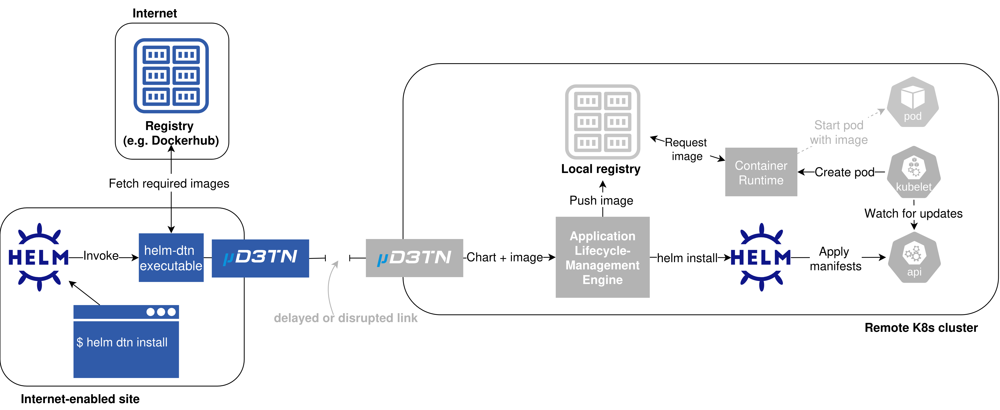
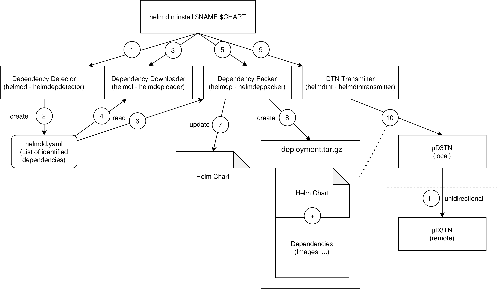
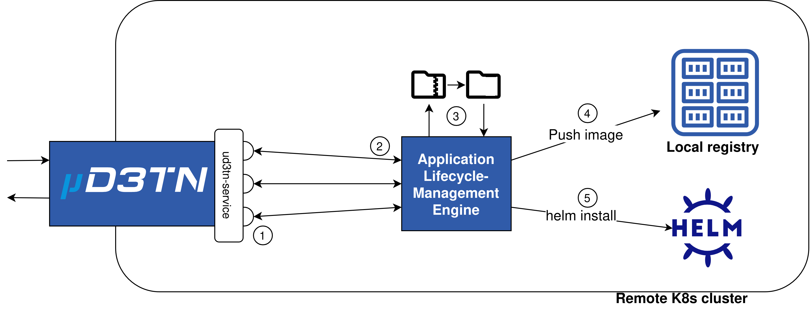

# Managing an Application using `helm-dtn`

## Overview
This document outlines the principles on which `helm-dtn` operates including the components it is made up of, the data flows between these components, and which operations are executed when and where.

## Background

When installing or updating software in systems without access to the Internet, the status quo is to manually transfer the required binaries and/or dependencies e.g. via an USB stick. While this works in regular deployments, there may be environments where such a manual transfer is not possible or requires  inproportionate amounts of resources (e.g. clusters in space, for remote sensing, or in underwater networks).

This plugin aims to address this issue by providing a way to install, upgrade and uninstall applications in such airgapped clusters through the use of Delay- and Disruption-tolerant Networking (DTN).

It assists in fetching required dependencies, bundling them with the chart and deploying everything over a one-way DTN link to a Kubernetes cluster.



The above is a visualization of the complete deployment process of an application using `helm-dtn`.

The following will explain how the `helm-dtn` Helm plugin works in detail, split into the Helm plugin running locally and the Application Lifecycle Management in the remote (potentially airgapped) cluster.

### The `helm-dtn` Helm Plugin

The `helm-dtn` plugin is made up of four distinct components outlined in the following figure:


Whenever a command is invoked (in this case `helm dtn install`) `helm-dtn` uses some or all of these components to prepare and send a corresponding command to the remote cluster. This process will be explained below using the `install` command as an example.

#### helmdd
When executing `helm dtn install`, `helm-dtn` first invokes `helmdd` - the Helm Dependency Detector (step **1** in the figure). This component then analyzes the provided Helm chart for dependencies (such as required images), that need to be available even if there is no connection to the internet. It does so by updating the subcharts (dependencies of the main Helm chart), before rendering the complete Helm chart into one YAML string. This string is then split into the different manifests and each manifest is recursively searched for the key "image", which signifies an image that needs to be downloaded. Once an image is found, it is added to a data structure for later reference. Once all manifests have been searched, this data structure is turned into a list of unique images per registry which in turn is marshaled into YAML in the form of:
```yaml
images:
    registry-name:
        - image-name:tag
        - image-name2:tag
    registry2-name:
        - image-name:tag
```

This is then exported to `.local/share/helm-dtn/helmdd.yaml` (step **2**).

#### helmdl
After the dependency list has been generated, `helm-dtn` calls `helmdl` - the Dependency Downloader (step **3**). This component is tasked with downloading all dependencies found by `helmdd`. It does so by first parsing the dependency list generated by `helmdd` (step **4**) and creating temporary directories for each resource type (e.g. a temporary directory "images/" for container images). Once these have been created, `helmdl` calls previously implemented "downloaders", small pieces of code that interface with whichever resource holds the data that needs to be downloaded. Going back to the example of container images, the `getImages` function first checks if an image in the required version is already available locally using `go-containerregistry` before using `Moby` to pull and save the image in case it isn't. This process is extensible to other resource types as well. The process of doing so for each component is documented in their respective subdirectories of the [/pkg](../pkg/) directory.

#### helmdp

Following the dependency download, the resources still need to be packaged. Furhtermore, a Helm chart update needs to be performed, so the local resources are actually used. This is where `helmdp` - the Dependency Packer takes over (step **5**). It uses the YAML file generated by `helmdd` as a reference for which dependency strings need to be updated (step **6**). Once all dependencies have been parsed, it unpacks all archives in the Helm chart's `subcharts` directory, so the files contained in these archives can also be updated. It then walks through all files in the chart directory, updating references as it goes (step **7**). While doing so, `helmdp` distinguishes two cases:
- the file is a clean YAML file (e.g. `values.yaml`)
- the file is a template (e.g. a `deployment.yaml`)

In the first case, the reference update can be done by recursively walking the YAML file until a reference that needs to be updated has been spotted. The second case can not use this method, as the templates are not valid YAML and can therefore not be parsed as such. In these cases a simple string replace is executed.

After all files have been updated, the modified Helm chart and all dependencies are added to a `.tar.gz` archive (step **8**).

#### helmdtnt

As the last action of the command definition, the DTN Transmitter `helmdtnt` is called (step **9**). This component interfaces with a Bundle Protocol implementation (usually µD3TN) via the Application Agent Protocol in version 2.0 (AAP2). In the case of an `install` or `upgrade` command it therefore reads the archive created by `helmdp` and sends it to a local µD3TN instance for forwarding (step **10**), which in turn sends it to a remote cluster via a unidirectional connection (step **11**).


### `helm-dtn` in the remote cluster
With the archive containing the Helm chart and required dependencies forwarded by µD3TN, the local `helm-dtn` instance is done and exits. Now the Application Lifecycle Management Engine in the remote cluster takes over.



The figure above only shows the `helm-dtn` related processes, without any Kubernetes-specific deployment logic. What remains is fairly simple: The Application Lifecycle Management Engine (ALME) (code available [here](../pkg/helmdtnt/receiver.go)) first registers three agents (`install`,`upgrade`,`delete`) at the µD3TN instance running in the cluster (step **1**). This allows the µD3TN instance from the previous section to send commands to the ALME, which are automatically associated with the correct action to be taken (i.e. if you want to install something, a command is sent to the `install` endpoint, when deleting something a command is sent to the `delete` endpoint, ...) (step **2**). In case an `install` or `upgrade` command are sent, the ALME next unpacks the attached archive, to gain access to the images, other dependencies and the Helm chart (step **3**). It then uses go-containerregistry to push the received images to the cluster registry (step **4**). Lastly, it executes a regular `helm install` or `helm upgrade` with the Helm chart it received (step **5**). For a `delete` command, the intermediate steps of unpacking an archive and pushing the images are not necessary - the `helm delete` command is directly executed.
