# TU Dresden DARKSOL Project

This repository contains the implementation and experimental evaluation of a
standalone container-image transfer workflow for disrupted and
delay-tolerant networks (DTN). The work transfers the Talos and Kubernetes
images needed by an existing Space-side cluster from an Earth-side registry
to a Space-side Harbor registry using Helm-DTN, AAP2, µD3TN, BPv7 and TCPCL.

The project evaluates image delivery under normal connectivity and temporary
network interruptions. It does **not** create a Kubernetes cluster, install
Talos, or configure a Kubernetes control plane.

## Helm-DTN image-transfer architecture


The implemented transfer route is:

```mermaid
flowchart LR
    A[Earth-side source registry] --> B[Existing Go image sender]
    B --> C[Pull container image]
    C --> D[Create OCI image layout]
    D --> E[Package OCI layout as TAR]
    E --> F[Metadata plus OCI TAR payload]
    F --> G[One AAP2 ADU]
    G --> H[Earth µD3TN]
    H -->|BPv7 over TCPCL| I[Space µD3TN]
    I --> J[AAP2 receiver]
    J --> K[Verify SHA-256]
    K --> L[Extract OCI layout]
    L --> M[Push to Space-side Harbor]
    M --> N[Compare source and destination digests]
```



The DTN layer can retain a bundle while the Earth-to-Space contact is
unavailable and forward it after connectivity returns. TCPCL is the
convergence layer used to carry BPv7 bundles over TCP when a contact exists.

## Cluster images evaluated

The experiment set is based on the images requested by the existing
`space-exec-env` Talos mirroring script:

| # | Source image | Purpose |
|---:|---|---|
| 1 | `ghcr.io/siderolabs/flannel:v0.27.4` | Pod networking/CNI |
| 2 | `registry.k8s.io/coredns/coredns:v1.13.2` | Kubernetes DNS |
| 3 | `registry.k8s.io/etcd:v3.6.7` | Cluster-state storage |
| 4 | `registry.k8s.io/kube-apiserver:v1.35.0` | Kubernetes API server |
| 5 | `registry.k8s.io/kube-controller-manager:v1.35.0` | Kubernetes controllers |
| 6 | `registry.k8s.io/kube-scheduler:v1.35.0` | Pod scheduling |
| 7 | `registry.k8s.io/kube-proxy:v1.35.0` | Service networking |
| 8 | `ghcr.io/siderolabs/kubelet:v1.35.0` | Kubernetes node agent |
| 9 | `registry.k8s.io/pause:3.10` | Pod sandbox image |
| 10 | `ghcr.io/siderolabs/installer:v1.12.4` | Talos installation and upgrade |

## Experimental evaluation

The existing sender and receiver are evaluated without reimplementing the
transfer protocol. Runs cover:

- normal network connectivity;
- temporary network interruptions of 10 seconds, 5 minutes and 1 hour;
- LEO, Lunar and Mars-inspired network profiles;
- repeated runs with individual log files and CSV records;
- payload size, total duration, CPU, memory, configured bandwidth and delay;
- delivery after reconnection, success/failure and error messages;
- source and destination digest comparison.

Each result must be interpreted using both the **reference RTT** and the
**actually applied RTT**. A contact-only run with `Applied RTT = 0 ms` tests
contact disruption and bandwidth recovery; it does not represent physical
Mars propagation latency.

## Repository layout

```text
helm-dtn-standalone-images/
└── tud-dtn-lifecycle-management/
    ├── cmd/                         # Sender/receiver commands
    ├── pkg/                         # AAP2, Helm and image-transfer packages
    ├── experiments/
    │   ├── scripts/                 # Experiment and plotting utilities
    │   ├── scenarios/               # Scenario configurations and outputs
    │   └── store-forward/
    │       ├── logs/                # Separate logs for individual runs
    │       ├── results/             # CSV, Excel, graphs and presentation
    │       └── PROFESSOR_EXPLANATION_CHART.md
    ├── web-dashboard/               # PHP results dashboard
    ├── .github/workflows/            # Project CI/CD definitions
    ├── helm_dtn_standalone_oci_transfer.png
    └── README.md
```

## Results and presentation

- [Raw store-and-forward results](helm-dtn-standalone-images/tud-dtn-lifecycle-management/experiments/store-forward/results/persistent_store_forward_results.csv)
- [Professor results workbook](helm-dtn-standalone-images/tud-dtn-lifecycle-management/experiments/store-forward/results/store_forward_professor_results.xlsx)
- [Experiment graphs](helm-dtn-standalone-images/tud-dtn-lifecycle-management/experiments/store-forward/results/graphs)
- [Presentation](helm-dtn-standalone-images/tud-dtn-lifecycle-management/experiments/store-forward/results/Helm_DTN_OCI_Image_Transfer_Experiments.pptx)
- [Explanation chart](helm-dtn-standalone-images/tud-dtn-lifecycle-management/experiments/store-forward/PROFESSOR_EXPLANATION_CHART.md)
- [Per-run logs](helm-dtn-standalone-images/tud-dtn-lifecycle-management/experiments/store-forward/logs)

## PHP results dashboard

Build and start the read-only dashboard from the repository root:

```bash
docker build -t dtn-results-dashboard \
  helm-dtn-standalone-images/tud-dtn-lifecycle-management/web-dashboard

docker run --rm -p 8080:80 \
  -v "$PWD/helm-dtn-standalone-images/tud-dtn-lifecycle-management/experiments/store-forward/results/persistent_store_forward_results.csv:/data/persistent_store_forward_results.csv:ro" \
  dtn-results-dashboard
```

Open <http://localhost:8080>.

## Important limitations

- Local emulation cannot reproduce every physical property of a space link.
- Reference RTT values are not measurements unless the corresponding delay
  was actually configured in the network emulator.
- Some Mars runs are contact-only because the available TCPCL configuration
  could not establish a session with a literal long one-way propagation delay.
- One-hour outages expose TCPCL session timeout and reconnection limitations;
  persistent DTN storage helps only when bundles are accepted and retained
  before the contact disappears.
- Throughput includes OCI packaging, DTN handling, reconnection and Harbor
  operations, so it is not a pure link-capacity measurement.

## CI/CD

The project includes workflows for Go tests/builds, PHP lint/tests, dashboard
container builds and GHCR publication. GitHub executes workflows only from the
top-level `.github/workflows/` directory of this repository; nested workflow
files are project templates until copied or adapted at the repository root.

## Integrity criterion

A transfer is considered successful only when delivery completes, the image
is pushed to the Space-side registry, and the source and destination SHA-256
digests match.
