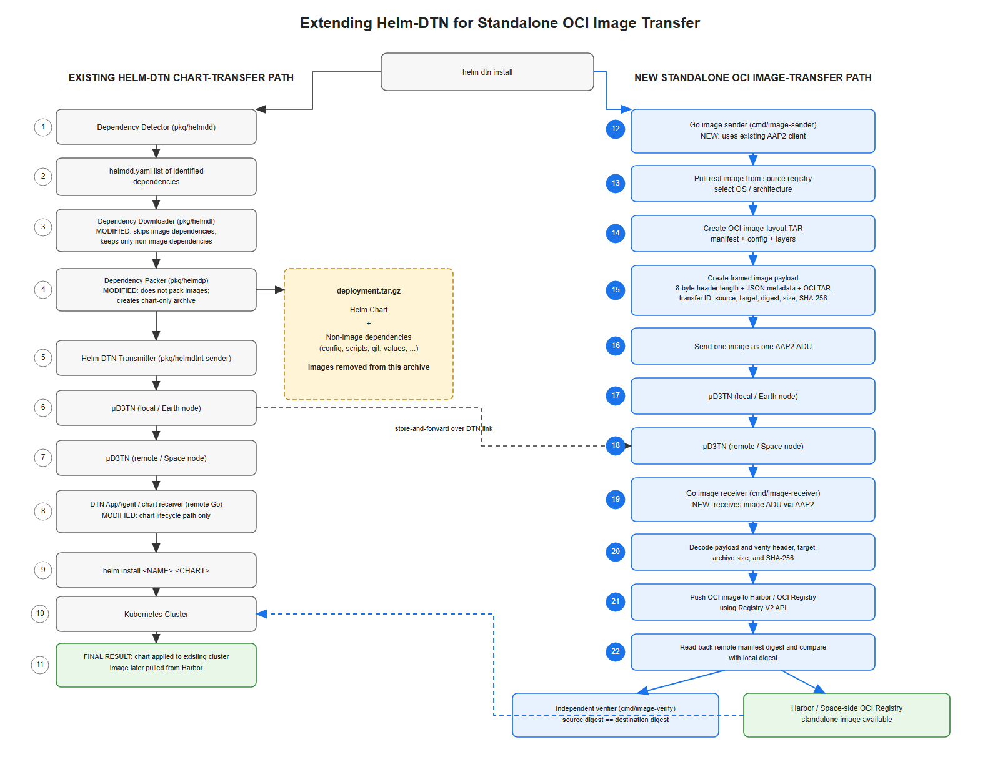

# tud-dtn-lifecycle-management — Helm-DTN

This repository contains the active Go implementation of Helm-DTN lifecycle
management and standalone OCI image transfer for disconnected or
DTN-connected environments.

The standalone workflow transfers Talos, Kubernetes, and application container
images before a Kubernetes cluster or Helm deployment exists. Earlier research
and the superseded Rust implementation are retained under
[`Archive/`](Archive/) and are not part of the active implementation.

## Standalone OCI image transfer

The standalone path pulls OCI images on the Earth side, packages each image as
an OCI image-layout archive, sends it as an AAP2 application data unit (ADU)
over µD3TN, and pushes it into the registry on the Space side. It does not
require Helm, a Helm chart, `kubectl`, or a running Kubernetes cluster.

[](helm_dtn_standalone_oci_transfer.drawio)


The Draw.io diagram documents both the original Helm chart-transfer path and
the new standalone OCI image-transfer path, including the Go packages and
commands used by each stage.

## Talos/Kubernetes image-transfer evaluation

The completed 10-image evaluation is organized under
[`experiments/`](experiments/). It reuses the predefined standalone OCI route;
it does not replace the sender, receiver, AAP2 client, µD3TN transport,
registry push, or digest-verification implementation. The evidence contains 10
normal and 10 temporary-interruption runs for each of the 10 configured images
(200 runs total). See [`experiments/RESULTS.md`](experiments/RESULTS.md).

## What was implemented

- `cmd/image-sender`: pulls one or more platform-specific images, creates OCI
  archives and framed transfer payloads, and submits them to µD3TN through the
  existing AAP2 client.
- `cmd/image-receiver`: subscribes to the Space-side AAP2 endpoint, streams
  received payloads to disk, verifies them, and pushes images to Harbor or
  another Registry V2 endpoint.
- `cmd/image-verify`: independently compares source and destination manifest
  digests after transfer.
- `pkg/imageplan`: validates repeated `-image`/`-registry-target` arguments and
  `SOURCE=TARGET` image-list files.
- `pkg/imagetransfer`: implements OCI export, payload framing, SHA-256 and size
  validation, registry push, and destination digest verification.
- `pkg/aap2_client`: retains the existing Helm-DTN AAP2 implementation and adds
  disk-streaming receive support and exact-length checks.
- `scripts/run-local-acceptance.sh`: exercises the complete local registry →
  µD3TN → registry path without Kubernetes.

Helm `install` and `upgrade` also use the standalone channel for detected image
dependencies. Images are sent independently to the `image-transfer` AAP2
agent; non-image dependencies and the rewritten chart continue through the
chart-transfer path. Images are therefore no longer packed into the chart
archive.

## Transfer format and integrity

Each image is sent independently as one AAP2 ADU:

```text
[8-byte big-endian JSON length][JSON transfer header][OCI image-layout TAR]
```

The header records the source reference and digest, destination target,
transfer UUID, creation time, archive size, and archive SHA-256. The receiver
checks the archive size and SHA-256 before opening it. After pushing the image,
it reads the destination manifest and requires its digest to match the source
manifest digest.

The sender streams files instead of loading a complete image into memory. This
version does not provide application-level chunking or partial-transfer resume.
In a one-way DTN, sender success means the Earth µD3TN node accepted the ADU;
final success is established on the Space side after registry read-back.

## Build

```bash
go build -o bin/image-transfer-send ./cmd/image-sender
go build -o bin/image-transfer-receive ./cmd/image-receiver
go build -o bin/image-transfer-verify ./cmd/image-verify
```

## Run the receiver on the Space side

```bash
REGISTRY_CREDS='user:password' ./bin/image-transfer-receive \
  -tcp 127.0.0.1:24242 \
  -agent-id image-transfer \
  -registry harbor.space.example/provisioning
```

For an anonymous registry, omit `REGISTRY_CREDS`. Use `-insecure-registry`
only with a plain-HTTP development registry.

## Send images from the Earth side

Send one image:

```bash
./bin/image-transfer-send \
  -tcp 127.0.0.1:14242 \
  -destination-eid dtn://space.dtn/image-transfer \
  -image registry.k8s.io/pause:3.10 \
  -registry-target kubernetes/pause:3.10
```

Repeat `-image` to transfer several images, or provide an image-list file:

```bash
./bin/image-transfer-send \
  -tcp 127.0.0.1:14242 \
  -destination-eid dtn://space.dtn/image-transfer \
  -images-file examples/talos-v1.13.6-kubernetes-v1.36.2-images.txt
```

Each non-comment line is either `SOURCE` or `SOURCE=TARGET`. If the target is
omitted, the source repository path and tag are preserved without the source
registry hostname.

## Verify the destination registry

```bash
REGISTRY_CREDS='user:password' ./bin/image-transfer-verify \
  -images-file examples/talos-v1.13.6-kubernetes-v1.36.2-images.txt \
  -registry harbor.space.example/provisioning
```

## Local acceptance test

```bash
./scripts/run-local-acceptance.sh
```

The test uses the existing local µD3TN harness and does not create a Kubernetes
cluster. Contact capacity must be sized for the complete encoded payload set;
large provisioning images can exceed low-rate contact plans.

## Helm lifecycle commands

The existing Helm plugin commands remain available:

```text
helm dtn configure
helm dtn install <chart>
helm dtn upgrade <chart>
helm dtn uninstall <release-name>
```

`configure` stores the remote EID, AAP2 socket or TCP address, and destination
registry. `install` and `upgrade` detect chart dependencies, send images through
the standalone OCI path, rewrite image references for the remote registry, and
send the chart separately. `uninstall` sends the lifecycle command through the
chart-management path.

## Repository structure

```text
.
├── cmd/
│   ├── image-sender/       Earth-side standalone sender
│   ├── image-receiver/     Space-side registry receiver
│   └── image-verify/       source/destination digest verifier
├── examples/               image-list examples
├── pkg/
│   ├── aap2_client/        existing Go AAP2 transport
│   ├── imageplan/          image request planning and validation
│   ├── imagetransfer/      OCI transfer and integrity implementation
│   ├── helmdd/             Helm dependency detection
│   ├── helmdl/             non-image dependency download
│   ├── helmdp/             chart rewriting and packaging
│   └── helmdtnt/           Helm chart DTN transport
├── scripts/                local acceptance workflow
├── STANDALONE-IMAGES.md    detailed standalone usage and evidence
├── PROVENANCE.md           baseline and implementation provenance
├── helm_dtn_standalone_oci_transfer.drawio
├── helm_dtn_standalone_oci_transfer.png
└── Archive/                superseded prototypes and research history
```

See [STANDALONE-IMAGES.md](STANDALONE-IMAGES.md) for detailed operational
notes, verified transfer evidence, and contact-capacity considerations.
