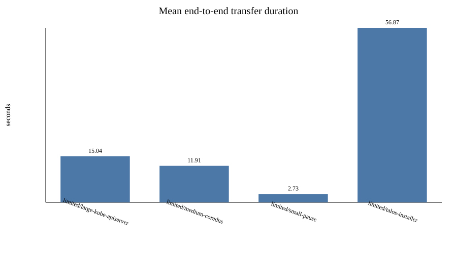
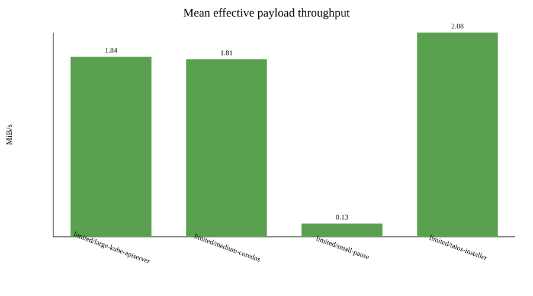
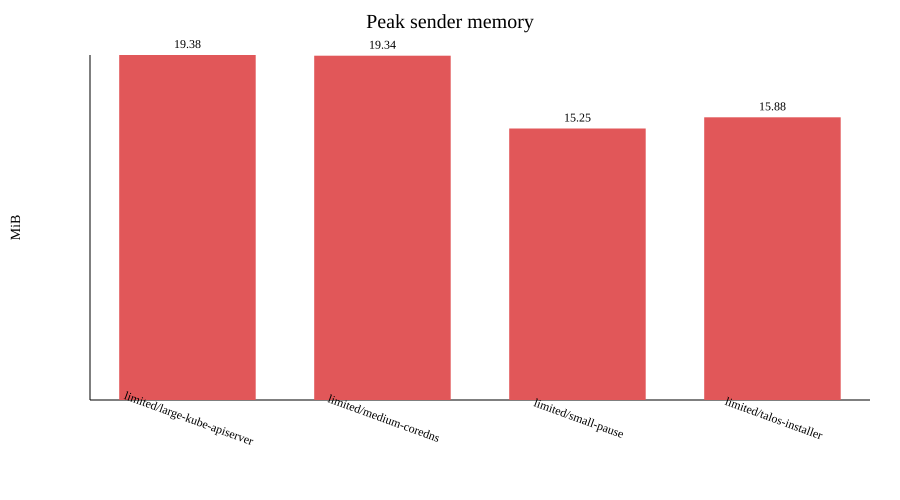

# Image-transfer benchmark report

Raw measurements: `results.csv`

| Profile | Image | Runs | Success | Payload MiB | Mean s | Min s | Max s | Stddev s | Mean MiB/s | Peak sender MiB | Peak receiver MiB | Sender CPU % | Receiver CPU % |
|---|---|---:|---:|---:|---:|---:|---:|---:|---:|---:|---:|---:|---:|
| limited | large-kube-apiserver | 10 | 10/10 | 27.36 | 15.04 | 12.99 | 17.99 | 1.50 | 1.84 | 19.38 | 14.48 | 35.0 | 6.8 |
| limited | medium-coredns | 10 | 10/10 | 21.36 | 11.91 | 10.52 | 13.07 | 1.16 | 1.81 | 19.34 | 14.10 | 39.0 | 6.1 |
| limited | small-pause | 10 | 10/10 | 0.31 | 2.73 | 0.79 | 3.87 | 0.78 | 0.13 | 15.25 | 12.50 | 15.0 | 2.4 |
| limited | talos-installer | 2 | 1/2 | 118.38 | 56.87 | 56.87 | 56.87 | 0.00 | 2.08 | 15.88 | 14.43 | 27.0 | 7.0 |

