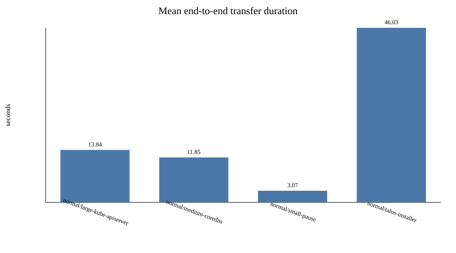
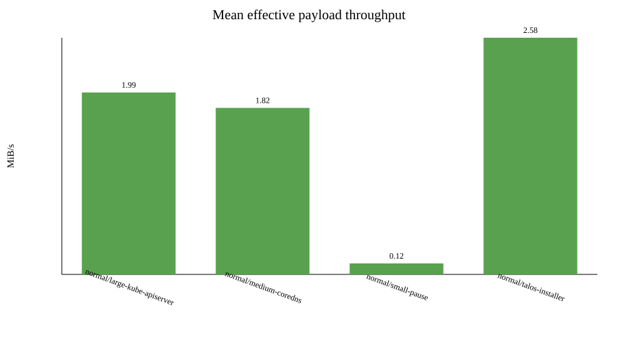
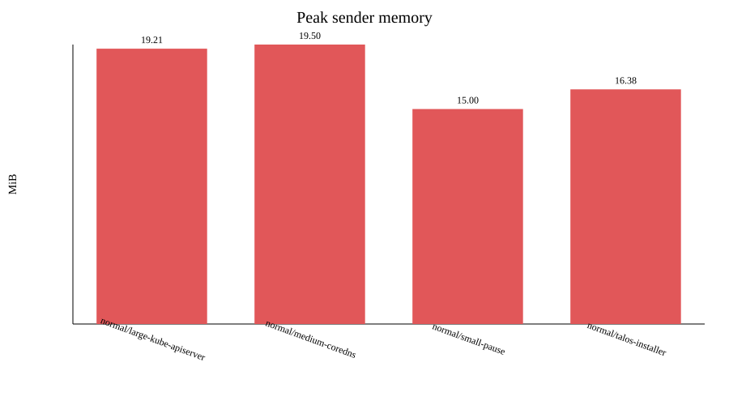

# Image-transfer benchmark report

Raw measurements: `results.csv`

| Profile | Image | Runs | Success | Payload MiB | Mean s | Min s | Max s | Stddev s | Mean MiB/s | Peak sender MiB | Peak receiver MiB | Sender CPU % | Receiver CPU % |
|---|---|---:|---:|---:|---:|---:|---:|---:|---:|---:|---:|---:|---:|
| normal | large-kube-apiserver | 10 | 10/10 | 27.36 | 13.84 | 11.79 | 15.12 | 0.97 | 1.99 | 19.21 | 14.56 | 34.0 | 5.6 |
| normal | medium-coredns | 10 | 10/10 | 21.36 | 11.85 | 10.70 | 13.95 | 1.16 | 1.82 | 19.50 | 14.12 | 36.0 | 5.1 |
| normal | small-pause | 10 | 10/10 | 0.31 | 3.07 | 1.35 | 8.03 | 1.79 | 0.12 | 15.00 | 11.88 | 88.0 | 1.8 |
| normal | talos-installer | 10 | 10/10 | 118.38 | 46.03 | 41.41 | 50.55 | 3.33 | 2.58 | 16.38 | 14.56 | 32.0 | 7.1 |

