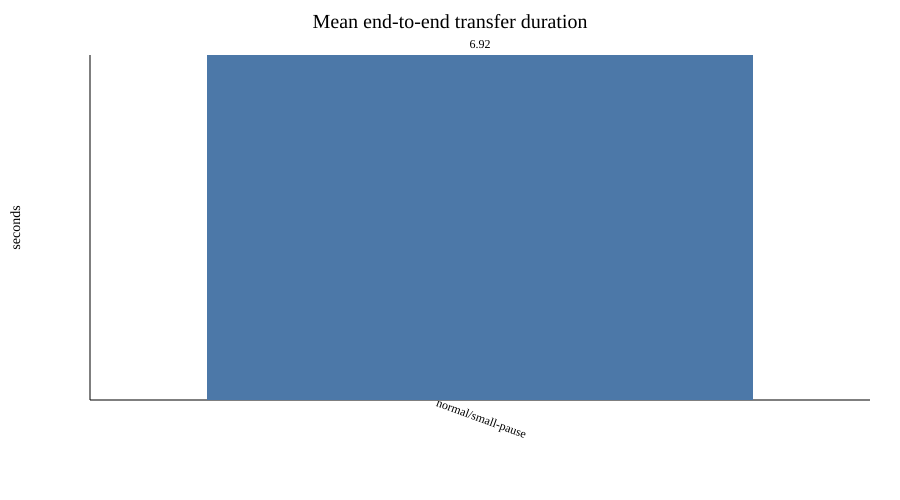
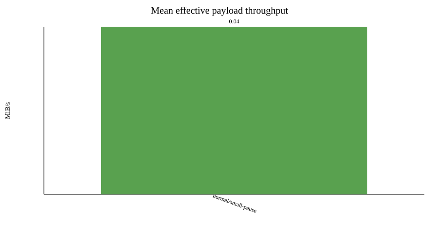
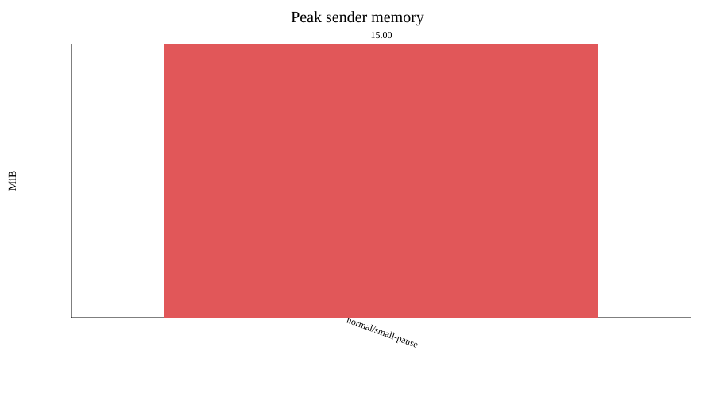

# Image-transfer benchmark report

Raw measurements: `results.csv`

| Profile | Image | Runs | Success | Payload MiB | Mean s | Min s | Max s | Stddev s | Mean MiB/s | Peak sender MiB | Peak receiver MiB | Sender CPU % | Receiver CPU % |
|---|---|---:|---:|---:|---:|---:|---:|---:|---:|---:|---:|---:|---:|
| normal | small-pause | 1 | 1/1 | 0.31 | 6.92 | 6.92 | 6.92 | 0.00 | 0.04 | 15.00 | 10.00 | 4.0 | 2.3 |

