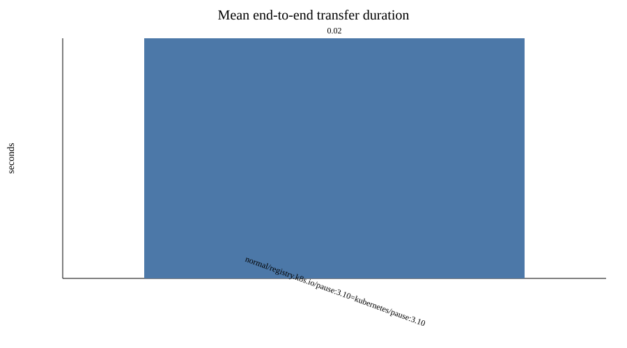
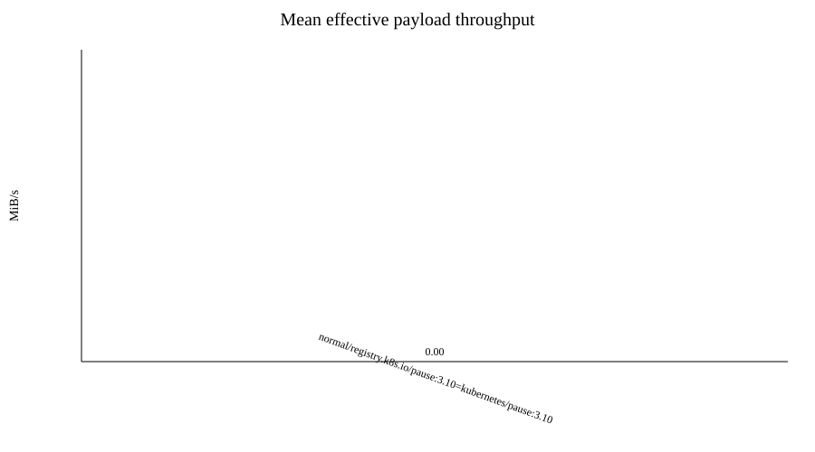
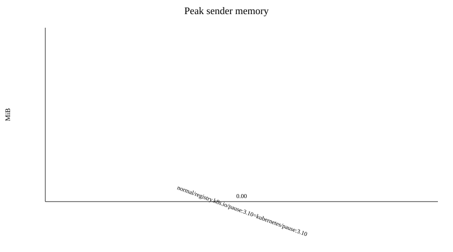

# Image-transfer benchmark report

Raw measurements: `results.csv`

| Profile | Image | Runs | Success | Payload MiB | Mean s | Min s | Max s | Stddev s | Mean MiB/s | Peak sender MiB | Peak receiver MiB | Sender CPU % | Receiver CPU % |
|---|---|---:|---:|---:|---:|---:|---:|---:|---:|---:|---:|---:|---:|
| normal | registry.k8s.io/pause:3.10=kubernetes/pause:3.10 | 1 | 0/1 | 0.00 | 0.02 | 0.02 | 0.02 | 0.00 | 0.00 | 0.00 | 0.00 | 0.0 | 0.0 |

