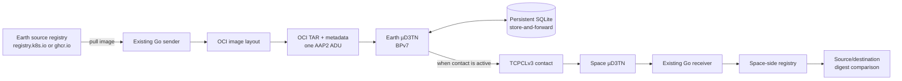
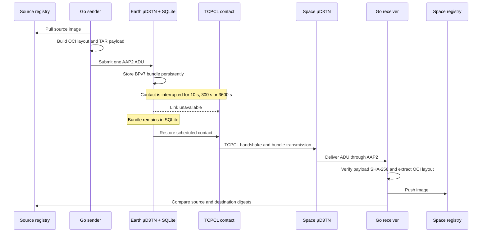
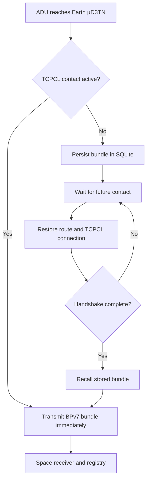
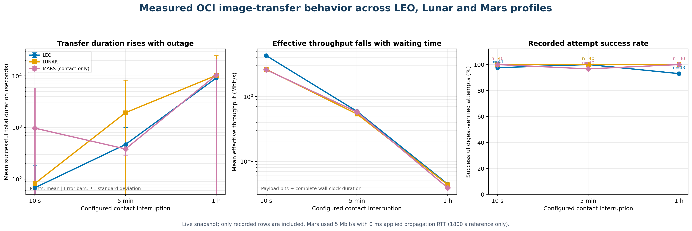

# OCI image transfer over Helm-DTN / µD3TN — explanation chart

> Status: live experiment snapshot. The complete configured set contains nine
> Kubernetes images and one Talos installer image. At the time of this note,
> Flannel, CoreDNS and etcd were complete, and kube-apiserver was in progress.

## 1. What “Helm-DTN image transfer” means

Helm does **not** copy a container image. Helm-DTN supplies the existing,
repeatable deployment and routing environment around µD3TN. The existing Go
sender and receiver perform the image-specific work; AAP2, BPv7, µD3TN and
TCPCL carry the resulting application data unit (ADU).

Why this route was selected:

| Reason | Meaning |
|---|---|
| Reuse the project design | Sender, receiver, OCI packaging, AAP2 transport and digest verification already existed. |
| Avoid rebuilding transfer logic | This task evaluates the existing implementation; it does not create another protocol. |
| OCI compatibility | Kubernetes and Talos images stay in a standard registry-compatible format. |
| DTN operation | BPv7/µD3TN can retain an ADU while the Earth–Space contact is unavailable. |
| Repeatable environment | Helm-DTN supplies a predefined, reproducible DTN route/configuration. |
| Integrity evidence | The destination registry digest is compared with the original source digest. |

No additional third-party image-transfer library was added. The implementation
uses the existing Go sender/receiver and the project’s µD3TN/AAP2 tooling.

## 2. Why these images were selected

The images were not selected arbitrarily. They come from the Talos cluster
image-mirroring requirement. There are **nine Kubernetes runtime images** and a
separate **tenth Talos installer image**.

| # | Image | Function | Group |
|---:|---|---|---|
| 1 | `ghcr.io/siderolabs/flannel:v0.27.4` | Pod networking/CNI | Kubernetes |
| 2 | `registry.k8s.io/coredns/coredns:v1.13.2` | Cluster DNS | Kubernetes |
| 3 | `registry.k8s.io/etcd:v3.6.7` | Cluster-state database | Kubernetes |
| 4 | `registry.k8s.io/kube-apiserver:v1.35.0` | Kubernetes API | Kubernetes |
| 5 | `registry.k8s.io/kube-controller-manager:v1.35.0` | Reconciliation controllers | Kubernetes |
| 6 | `registry.k8s.io/kube-scheduler:v1.35.0` | Pod scheduling | Kubernetes |
| 7 | `registry.k8s.io/kube-proxy:v1.35.0` | Service networking | Kubernetes |
| 8 | `ghcr.io/siderolabs/kubelet:v1.35.0` | Node agent | Kubernetes |
| 9 | `registry.k8s.io/pause:3.10` | Pod sandbox | Kubernetes |
| 10 | `ghcr.io/siderolabs/installer:v1.12.4` | Talos install/upgrade image | Talos |

The first nine allow an existing Talos-managed Kubernetes cluster to obtain its
runtime images from the Space-side registry. The tenth supports Talos
installation/upgrades. This work transfers prerequisites; it does not create or
configure a Kubernetes control plane.

## 3. Experimental method

Each condition is intended to have ten successful repetitions. Every run
records payload size, timestamps, duration, CPU, memory, throughput,
interruption/reconnection state, digests, success/failure and error text.

## 4. Why LEO, Lunar and Mars were selected

They represent increasing communication distance and increasingly difficult
contact conditions.

| Scenario | Applied bandwidth | Applied RTT | Reference RTT | Meaning |
|---|---:|---:|---:|---|
| LEO | 15 Mbit/s | 50 ms | 50 ms | Short Earth-orbit link; relatively low propagation delay. |
| Lunar | 20 Mbit/s | 2.6 s | 2.6 s | Approximately 1.3 s one-way propagation delay. |
| Mars | 5 Mbit/s | **0 ms** | 1800 s | Contact-only Mars feasibility profile; Mars propagation delay was not emulated. |

Bandwidth and RTT describe different properties:

- **Bandwidth** is the link capacity (bits per second).
- **RTT** is the time for a signal to travel to the remote endpoint and back.
- Greater distance increases propagation RTT, but bandwidth also depends on
  antennas, transmit power, modulation, coding, ground stations and link budget.
- The selected Lunar profile having 20 Mbit/s while LEO has 15 Mbit/s does not
  imply Lunar links are always faster; they are different controlled profiles.
- The 5 Mbit/s Mars rate is a representative return-link test value, not a
  universal or symmetric Mars link guarantee.

The Mars profile must never be described as a full Mars-latency test. A literal
1800 s RTT would require roughly 900 s one-way delay in each direction. The
installed TCPCL setup could not establish reliably with that imposed delay, so
the actual experiments retained 5 Mbit/s bandwidth and contact disruption but
used 0 ms added propagation delay.

## 5. Why 10 seconds, 5 minutes and 1 hour were used

| Interruption | Purpose | Expected behavior |
|---|---|---|
| 10 seconds | Brief contact loss | Bundle waits briefly, then delivery resumes. |
| 5 minutes | Medium outage | Demonstrates that delivery is delayed rather than immediately abandoned. |
| 1 hour | Long disruption | Tests persistent storage, later contact recovery and operational robustness. |

Ten-second and five-minute runs usually finish because the processes and TCPCL
session remain alive long enough for contact restoration. One-hour runs expose
additional host and implementation limitations. They are not universally
unsuccessful: many one-hour runs passed after persistent store-and-forward
recovery, but they often took longer than 3600 seconds.

### Contact-window model used in every scenario

```mermaid
gantt
    title Experiment-controlled contact windows (schematic, not to scale)
    dateFormat X
    axisFormat %s
    section LEO
    Contact available     :0, 10
    Contact unavailable   :crit, 10, 30
    Contact restored      :30, 50
    section Lunar
    Contact available     :0, 10
    Contact unavailable   :crit, 10, 30
    Contact restored      :30, 50
    section Mars contact-only
    Contact available     :0, 10
    Contact unavailable   :crit, 10, 30
    Contact restored      :30, 50
```

For every LEO, Lunar and Mars condition, the sender first submits the ADU while
the Earth node is operating. The Earth-to-Space TCPCL path is then made
unavailable for the configured 10 s, 300 s or 3600 s interval. After that
interval, the route/contact is restored, TCPCL completes its handshake, and the
stored bundle is recalled. The diagram is schematic: it does not claim a real
satellite pass, lunar visibility schedule or DSN Mars contact plan. The actual
timestamps for each run are stored in `interruption_start_time` and
`reconnection_time`.

## 6. TCPCL versus DTN store-and-forward

| Component | What it provides | Strength | Limitation seen here |
|---|---|---|---|
| TCPCLv3 | A convergence-layer connection that sends bundles over TCP | Efficient on a currently available, stable IP path | It still depends on a live TCP connection and handshake. It is not itself persistent storage. |
| BPv7/µD3TN | Bundle addressing, routing and delay/disruption-tolerant behavior | Separates bundle lifetime from one continuous end-to-end session | Correct contacts, lifetime and storage/recall rules are required. |
| SQLite store-and-forward | Disk-backed retention at Earth | Preserves the submitted ADU during long contact loss | The bundle must be recalled only after TCPCL becomes active. |

TCPCL worked well for short and stable contacts. During long outages, the TCP
connection disappeared and had to be re-established. An early implementation
recalled the stored bundle as soon as the contact was scheduled, before the
TCPCL handshake completed. µD3TN then reported the Space link as inactive. The
restore script was corrected to wait 15 seconds after contact configuration and
only then recall the SQLite bundle.

## 7. What happened after persistent DTN was used

1. The sender submitted the ADU once.
2. Earth µD3TN wrote the bundle to SQLite instead of requiring a continuous
   end-to-end path.
3. The Earth-to-Space TCPCL path was intentionally blocked.
4. After restoration, TCPCL reconnected and completed its handshake.
5. The storage agent recalled the original bundle.
6. The Space receiver verified the payload and pushed the image.
7. Matching source and destination digests proved content integrity.

This proves store-and-forward delivery for successful runs. It does not prove
that the sender retransmitted the image; the intended success case uses the
original disk-backed bundle.

## 8. Current measured outcome snapshot

How to read this graph:

- The left panel rises because total duration includes time waiting for the
  contact to return. Error bars show that WSL suspension and recovery timing
  produced high variability, especially for long runs.
- The middle panel falls because effective throughput is calculated as the
  complete payload divided by total wall-clock duration. The physical link
  capacity did not necessarily fall during an active contact; waiting time made
  end-to-end effective throughput lower.
- The right panel shows the success fraction for every recorded attempt, not
  only the successful repetitions. The `n=` labels show how many attempts were
  available in this live snapshot.
- Mars remains labelled `contact-only` because its 1800 s reference RTT was not
  applied to the network emulator.

The live CSV currently contains complete 10-run conditions for Flannel,
CoreDNS and etcd, and partial kube-apiserver results. Five failed attempts are
preserved: four receiver-completion timeouts and one sender connection refusal.
They were not converted into successful measurements.

| Image | Scenario coverage now | Main observation |
|---|---|---|
| Flannel | LEO/Lunar/Mars; all three outage durations | Ten successful repetitions were obtained for most conditions; additional failed attempts remain visible. |
| CoreDNS | LEO/Lunar/Mars; all three outage durations | Ten successful runs are recorded for each condition. |
| etcd | LEO/Lunar/Mars; all three outage durations | Nearly all conditions have 10/10 successes; Mars 5-minute data contains one failed attempt in addition to successful attempts. |
| kube-apiserver | LEO complete; Lunar currently progressing | Long runs pass, but WSL suspension can greatly extend wall-clock duration. |
| Remaining six configured images | Not yet reached by the live matrix | No conclusion should be claimed until their rows exist. |

## 9. Limitations that must be stated

| Limitation | Consequence |
|---|---|
| WSL/host suspension pauses Linux sleep timers | A configured one-hour outage sometimes lasts many wall-clock hours. Total duration then measures host suspension as well as networking. |
| Mars RTT was not applied | Mars results test bandwidth/contact disruption and DTN recovery, not physical Mars propagation latency. |
| Controlled local environment | CPU, memory and throughput are properties of this host and setup, not spacecraft hardware. |
| TCPCL is TCP-based | Very large RTT can make connection establishment, acknowledgements and timeout behavior impractical without tuning or a different convergence-layer strategy. |
| One ADU contains the full OCI TAR | Large images require large bundle storage and memory/disk resources; partial application-level resume is not demonstrated. |
| Success after reconnection instrumentation | Some historical rows have incomplete `completed_after_reconnection` metadata because manual recovery or stale marker files preceded later script fixes. Digest success remains valid, but those rows should not independently prove reconnection timing. |
| Matrix still running | Results are incomplete for all ten configured images. |
| Scenario parameters are representative | They do not model antenna physics, asymmetric forward/return links, variable Mars distance, weather, bit errors or scheduled DSN contacts. |

## 10. Short explanation for a presentation

> I reused the project’s existing Helm-DTN/µD3TN standalone OCI route rather
> than implementing another image-transfer protocol. The nine Kubernetes
> runtime images, plus the Talos installer image, were selected from the Talos
> mirroring requirement. Each image is pulled on Earth, packaged as an OCI TAR,
> submitted as one AAP2 ADU, stored and routed as a BPv7 bundle, delivered over
> TCPCL when contact exists, pushed into the Space registry, and verified using
> matching source and destination digests. I evaluated representative LEO,
> Lunar and Mars-contact profiles with 10-second, 5-minute and 1-hour outages.
> Short outages mainly exercised TCPCL reconnection; long outages required
> persistent SQLite store-and-forward. The main limitations are WSL timer
> suspension, the lack of applied Mars propagation RTT, and the fact that the
> measurements come from a controlled local host rather than flight hardware.
